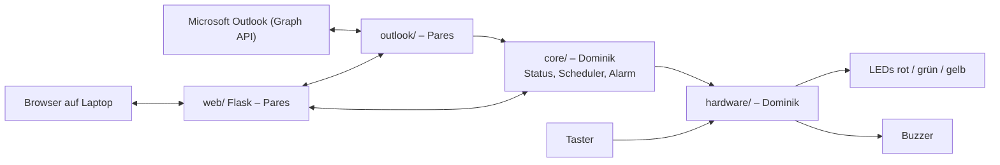
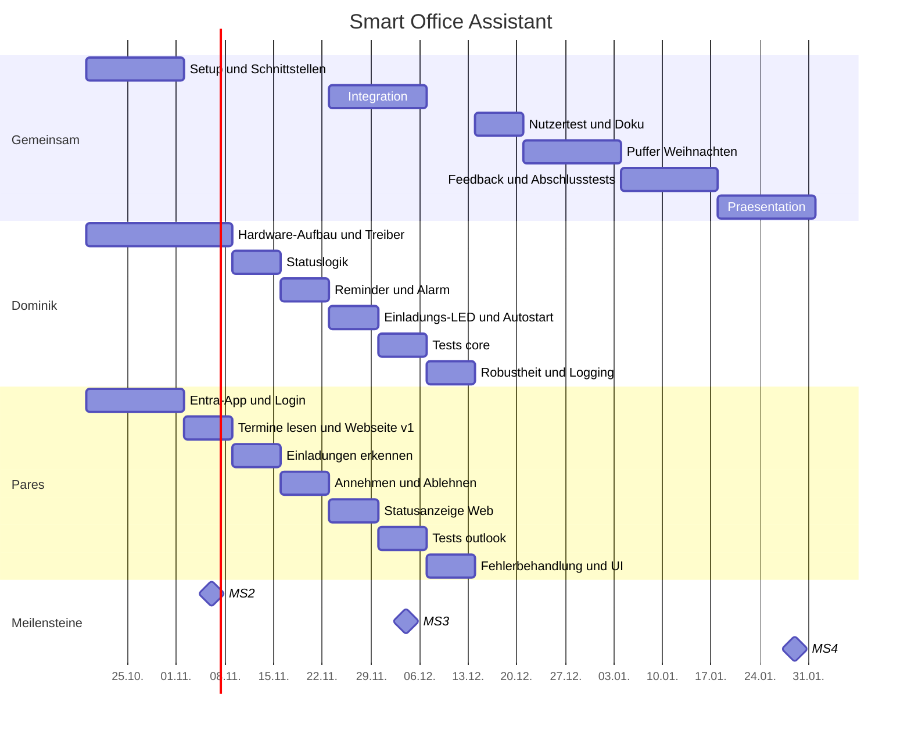

# Smart Office Assistant – Projektplan

**Modul:** Software Engineering III
**Team:** Pares Fotidis, Dominik Stich
**Zeitraum:** KW 43/2026 – KW 04/2027 (Abgabegespräche Februar 2027)

---

## 1. Projektidee

Ein Raspberry Pi 5 als Terminassistent auf dem Schreibtisch, verbunden mit Microsoft Outlook. Er erkennt neue Termine und Einladungen, erinnert mit Licht und Ton an Meetings, zeigt den Status „beschäftigt“ / „verfügbar“ an und ermöglicht die Terminverwaltung über eine Webseite auf dem Laptop des Nutzers.

---

## 2. Funktionen und Aufteilung

Jede Funktion besteht aus einem Hardware-/Logik-Teil (Dominik) und einem Outlook-/Web-Teil (Pares). So arbeiten beide gleichzeitig an derselben Funktion, jeder Teil ist aber klar einer Person zugeordnet.

| ID | Funktion | Dominik (Hardware & Gerätelogik) | Pares (Outlook & Web) |
|----|----------|----------------------------------|-----------------------|
| F1 | Neue Einladungen erkennen | Gelbe LED blinkt, solange offene Einladungen existieren | Outlook regelmäßig abfragen, unbeantwortete Einladungen erkennen |
| F2 | Termine am Laptop annehmen/ablehnen | LED stoppt nach Antwort | Webseite mit Annehmen/Ablehnen, Antwort an Outlook senden |
| F3 | Alarm 10 Min vor Meeting | Reminder-Scheduler, Buzzer-Tonmuster | Termindaten (Start, Betreff) bereitstellen |
| F4 | Status rot = beschäftigt, grün = verfügbar | Statuslogik + LED-Steuerung | Belegt/Frei-Information aus Outlook (`showAs`), Status auf Webseite anzeigen |
| F5 | Alarm per Knopf ausschalten | Taster, Entprellung, Alarm quittieren | Quittierten Alarm auf Webseite anzeigen |

---

## 3. Rollen

| Person | Verantwortungsbereich | Ordner im Repo |
|--------|----------------------|----------------|
| **Dominik** | Hardware-Aufbau, GPIO-Treiber (LEDs, Buzzer, Taster), Gerätelogik (Status, Reminder-Scheduler, Alarm), Autostart auf dem Pi | `hardware/`, `core/` |
| **Pares** | Microsoft-Graph-Anbindung (Login, Termine lesen, Einladungen, Annehmen/Ablehnen), Webinterface | `outlook/`, `web/` |
| **Beide** | Schnittstellen, Integration (`main.py`), End-to-End-Tests, Dokumentation, Präsentation | `shared/`, `tests/e2e/`, `docs/` |

---

## 4. Architektur



### Schnittstellen (in KW 44 gemeinsam festlegen)

Beide programmieren gegen diese Schnittstellen und nutzen bis zur Integration **Mocks** der jeweils anderen Seite. Dadurch kann parallel gearbeitet werden.

```python
# shared/models.py
@dataclass
class CalendarEvent:
    id: str
    subject: str
    start: datetime
    end: datetime
    show_as: str          # "busy", "free", "tentative", ...
    response: str         # "accepted", "declined", "notResponded", ...

# shared/interfaces.py
class CalendarService(Protocol):           # implementiert: Pares
    def get_upcoming_events(self, hours: int) -> list[CalendarEvent]: ...
    def get_open_invitations(self) -> list[CalendarEvent]: ...
    def respond(self, event_id: str, accept: bool) -> None: ...

class HardwareController(Protocol):        # implementiert: Dominik
    def set_status(self, busy: bool) -> None: ...
    def set_invitation_blink(self, active: bool) -> None: ...
    def start_alarm(self) -> None: ...
    def stop_alarm(self) -> None: ...
    def on_button_pressed(self, callback: Callable[[], None]) -> None: ...
```

### Repo-Struktur

```
smart-office-assistant/
├── hardware/        # Dominik: leds.py, buzzer.py, button.py, controller.py
├── core/            # Dominik: status.py, scheduler.py, alarm.py
├── outlook/         # Pares: auth.py, client.py, invitations.py
├── web/             # Pares: app.py, templates/, static/
├── shared/          # Beide: models.py, interfaces.py, mocks.py
├── tests/           # unit/ (je Person), e2e/ (gemeinsam)
├── docs/            # Doku, Schaltplan, Meeting-Protokolle
├── main.py          # Beide: verbindet alle Module
├── requirements.txt
├── .env.example     # keine echten Secrets im Repo
└── README.md
```

---

## 5. Arbeitspakete

| WP | Aufgabe | Verantwortlich | Review | Zeitraum |
|----|---------|----------------|--------|----------|
| WP1 | Planung, Repo-Setup, Schnittstellen | Beide | – | KW 42–44 |
| WP2 | Hardware-Aufbau & GPIO-Treiber | Dominik | Pares | KW 43–45 |
| WP3 | Gerätelogik: Status, Reminder, Alarm, Autostart | Dominik | Pares | KW 46–50 |
| WP4 | Outlook-Anbindung (Graph API) | Pares | Dominik | KW 43–47 |
| WP5 | Webinterface | Pares | Dominik | KW 45–50 |
| WP6 | Integration & Tests | Beide (je eigene Testfälle) | gegenseitig | KW 48–02 |
| WP7 | Dokumentation & Präsentation | Beide (je eigene Kapitel/Folien) | gegenseitig | KW 51–04 |

---

## 6. Meilensteine

| MS | Was ist fertig? | Wann? |
|----|-----------------|-------|
| MS1 | Projektidee und Aufgabenverteilung | KW 42 |
| MS2 | Hardware per Python steuerbar, Outlook-Login funktioniert, erste Webseite zeigt Termine | KW 45 |
| MS3 | Alle Funktionen F1–F5 laufen End-to-End auf dem Pi | KW 49 |
| MS4 | Fertiges Projekt (Release v1.0) und Präsentation | KW 04/2027 |
| MS5 | Persönliche Berichte und Abgabegespräche | Februar 2027 |

---

## 7. Wochenplan

### KW 43 (19.10.–25.10.) – Setup
**Ziel:** Arbeitsumgebung steht, Outlook-Zugriff geklärt.

**Gemeinsam**
- [ ] GitHub-Repo, Branch-Regeln, Labels, Project-Board anlegen
- [ ] Bauteile prüfen, Fehlendes bestellen

**Dominik**
- [ ] Raspberry Pi OS (64 Bit) installieren, SSH, Python-venv
- [ ] `gpiozero` (mit `lgpio`) testen – `RPi.GPIO` läuft nicht auf dem Pi 5
- [ ] Schaltplan mit Pinbelegung und Widerständen zeichnen (`docs/hardware/`)

**Pares**
- [ ] App in Microsoft Entra registrieren, Berechtigung `Calendars.ReadWrite`
- [ ] Prüfen, ob das Hochschulkonto App-Zustimmung erlaubt (sonst privates Outlook.com-Konto)
- [ ] Termine testweise im Graph Explorer abrufen

**Ergebnis:** Repo steht, Pi per SSH erreichbar, Graph-Zugriff funktioniert.

---

### KW 44 (26.10.–01.11.) – Schnittstellen & Prototypen
**Ziel:** Jede Komponente einzeln lauffähig.

**Gemeinsam**
- [ ] `shared/models.py`, `shared/interfaces.py` und `shared/mocks.py` festlegen

**Dominik**
- [ ] Breadboard aufbauen: LEDs rot/grün/gelb, Taster, Buzzer
- [ ] `hardware/leds.py`, `buzzer.py`, `button.py` + Testskript

**Pares**
- [ ] `outlook/auth.py`: Login über MSAL (Device-Code-Flow), Token-Cache
- [ ] `outlook/client.py`: Termine der nächsten 24 h lesen (`calendarView`)

**Ergebnis:** LEDs/Buzzer/Taster per Skript steuerbar, Termine per Skript lesbar.

---

### KW 45 (02.11.–08.11.) – Meilenstein 2
**Ziel:** MS2 erreicht.

**Dominik**
- [ ] `hardware/controller.py`: `HardwareController` vollständig (Blinkmuster, Tonmuster, entprellter Taster mit Callback)
- [ ] Unit-Tests mit gpiozero `MockFactory` (laufen auch ohne Pi)

**Pares**
- [ ] `web/app.py` (Flask): Seite „Heute“ mit Terminliste aus Outlook
- [ ] Basis-Layout (Templates, CSS)

**Gemeinsam**
- [ ] MS2-Demo, gegenseitiges Code-Review

**Ergebnis:** MS2.

---

### KW 46 (09.11.–15.11.) – Status & Einladungen
**Ziel:** F1 und F4 jeweils auf der eigenen Seite fertig.

**Dominik**
- [ ] `core/status.py`: aktueller Termin mit `showAs = busy` → rote LED, sonst grün
- [ ] Tests gegen Mock-`CalendarService`

**Pares**
- [ ] `outlook/invitations.py`: unbeantwortete Einladungen erkennen
- [ ] Bereits gesehene Einladungen speichern (keine Doppelmeldungen)

**Gemeinsam**
- [ ] Polling-Intervall und Verhalten bei Fehlern festlegen

---

### KW 47 (16.11.–22.11.) – Erinnerungen & Annehmen/Ablehnen
**Ziel:** F2, F3 und F5 jeweils auf der eigenen Seite fertig.

**Dominik**
- [ ] `core/scheduler.py`: Alarm 10 Min vor Terminbeginn, keine Doppel-Alarme, Zeitzone Europe/Berlin
- [ ] `core/alarm.py`: Buzzer an → Taster stoppt → automatisches Ende nach Timeout

**Pares**
- [ ] Annehmen/Ablehnen über Graph (`/accept`, `/decline`)
- [ ] Webseite: Liste offener Einladungen mit Buttons

---

### KW 48 (23.11.–29.11.) – Integration
**Ziel:** Alle Module laufen gemeinsam auf dem Pi.

**Gemeinsam**
- [ ] `main.py`: Module verbinden, Mocks durch echte Implementierungen ersetzen
- [ ] Erster Integrationstest auf dem Pi

**Dominik**
- [ ] Einladungs-LED an Anzahl offener Einladungen koppeln
- [ ] Autostart per `systemd`-Service

**Pares**
- [ ] Webseite zeigt Gerätestatus (beschäftigt/verfügbar, Alarm aktiv/quittiert), automatisches Aktualisieren
- [ ] Zugriff vom Laptop auf den Pi im lokalen Netz einrichten

---

### KW 49 (30.11.–06.12.) – Meilenstein 3
**Ziel:** MS3 – F1–F5 End-to-End.

**Gemeinsam**
- [ ] End-to-End-Testfälle durchspielen, Testprotokoll in `docs/tests/`
- [ ] Bugfixing, MS3-Demo

**Dominik**
- [ ] Unit-Tests `core/` vervollständigen

**Pares**
- [ ] Unit-Tests `outlook/` mit gemockten Graph-Antworten (inkl. abgelaufenes Token)

**Ergebnis:** MS3.

---

### KW 50 (07.12.–13.12.) – Robustheit
**Dominik**
- [ ] Logging, Verhalten nach Neustart und bei Netzausfall (z. B. Fehler-Blinkmuster)
- [ ] Code-Kommentare/Docstrings `hardware/`, `core/`

**Pares**
- [ ] Fehlerbehandlung in Web und Outlook-Client (Graph nicht erreichbar)
- [ ] Secrets in `.env`, `.gitignore` prüfen, Webseite nur im lokalen Netz

---

### KW 51 (14.12.–20.12.) – Nutzertest & Doku Teil 1
**Gemeinsam**
- [ ] Nutzertest mit 2–3 Personen, Feedback als Issues erfassen

**Dominik**
- [ ] Doku: Hardware (Schaltplan, Pinbelegung, Stückliste), Gerätelogik

**Pares**
- [ ] Doku: Outlook-Anbindung (Login-Ablauf, Berechtigungen), Webinterface

---

### KW 52–53 (21.12.–03.01.) – Weihnachten / Puffer
- [ ] Nur offene Issues und Bugs, keine neuen Features

---

### KW 01 (04.01.–10.01.) – Feedback umsetzen
**Dominik**
- [ ] Feedback-Issues Hardware/Logik umsetzen

**Pares**
- [ ] Feedback-Issues Outlook/Web umsetzen

---

### KW 02 (11.01.–17.01.) – Feature-Freeze & Abschlusstests
**Gemeinsam**
- [ ] Feature-Freeze, kompletter Regressionstest
- [ ] Release `v1.0` taggen

**Dominik**
- [ ] Testprotokoll Hardware & Gerätelogik

**Pares**
- [ ] Testprotokoll Outlook & Web

---

### KW 03 (18.01.–24.01.) – Präsentation
**Gemeinsam**
- [ ] Demo-Ablauf festlegen, Backup-Video der Demo aufnehmen

**Dominik**
- [ ] Folien: Hardware, Gerätelogik

**Pares**
- [ ] Folien: Outlook-Anbindung, Webinterface

---

### KW 04 (25.01.–31.01.) – Meilenstein 4
- [ ] Probelauf der Präsentation
- [ ] README und Doku final
- [ ] Präsentation halten

**Ergebnis:** MS4.

---

### Februar 2027 – Meilenstein 5
- [ ] Persönliche Berichte (jeder mit Verweis auf eigene Issues, Commits und PRs)
- [ ] Abgabegespräche

---

## 8. Gantt-Diagramm



---

## 9. Nachweis der Arbeitsteilung (Git-Workflow)

- **Issues:** Jede Aufgabe ist ein Issue mit genau einer verantwortlichen Person (Assignee), Label `dominik` / `pares` / `gemeinsam`, WP-Label und Meilenstein.
- **Branches:** `feature/dominik-<thema>` bzw. `feature/pares-<thema>`; kein direkter Push auf `main`.
- **Pull Requests:** Jeder PR wird von der jeweils anderen Person reviewt.
- **Gemeinsame Arbeit:** Bei Pair-Programming im Commit `Co-authored-by: Name <mail>` angeben, damit beide auf GitHub sichtbar sind.
- **Protokolle:** Kurzes Wochenprotokoll in `docs/meetings/KWxx.md` (erledigt, offen, Probleme).

---

## 10. Risiken

| Risiko | Gegenmaßnahme |
|--------|---------------|
| Hochschul-Microsoft-Konto erlaubt keine App-Zustimmung | Privates Outlook.com-Konto für Entwicklung und Demo |
| GPIO-Bibliothek inkompatibel mit Pi 5 | `gpiozero` mit `lgpio` statt `RPi.GPIO` |
| Hochschul-WLAN verhindert Zugriff Laptop → Pi | Handy-Hotspot für Entwicklung und Demo |
| Live-Demo scheitert (Netz, Outlook) | Backup-Video (KW 03) |
| Zeitverzug | Puffer KW 52–53, Feature-Freeze KW 02 |
| Ausfall einer Person | Reviews und Doku sorgen dafür, dass beide den Code kennen |

---

## 11. Bauteile

| Bauteil | Anzahl |
|---------|--------|
| Raspberry Pi 5 + USB-C-Netzteil (27 W) | 1 |
| microSD-Karte (≥ 32 GB) | 1 |
| Breadboard + Jumper-Kabel | 1 Set |
| LED rot / grün / gelb | je 1 |
| Widerstand 220–330 Ω (für LEDs) | 3 |
| Aktiver Buzzer | 1 |
| Taster | 1 |
| Laptop des Nutzers (Browser) | 1 |

**Pinbelegung (Vorschlag):** GPIO17 = LED rot, GPIO27 = LED grün, GPIO22 = LED gelb, GPIO23 = Buzzer, GPIO24 = Taster (interner Pull-up).

---

**Ziel:** Am Ende steht ein Terminassistent auf dem Schreibtisch, der selbstständig auf Outlook-Termine reagiert und an Meetings erinnert.
